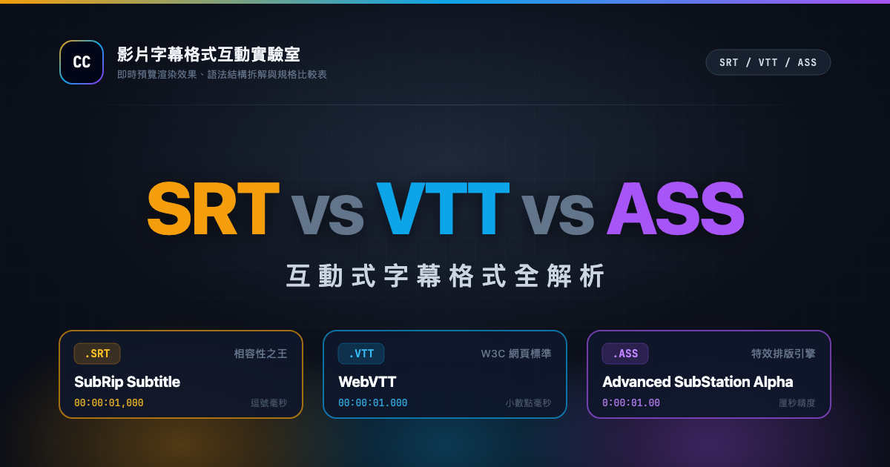

# SRT vs VTT vs ASS — 影片字幕格式互動實驗室

一次搞懂三大字幕格式的差異，用互動實驗挑出最適合你專案的那一個。



## 線上預覽

直接瀏覽 GitHub Pages 線上版本：https://subtitle-formats.gh.miniasp.com/

## 簡介

這是一個單一 HTML 檔案的互動式網頁教學，深入淺出地比較 SRT (SubRip)、WebVTT、ASS/SSA (Advanced SubStation Alpha) 三大主流字幕格式。無論你是影片剪輯師、前端工程師，或只是正在為作品挑選字幕格式的創作者，都能透過即時互動與視覺化對比，快速掌握每個格式的語法結構、適用場景與取捨。

## 功能特色

- 三大格式總覽卡：SRT 相容性之王 / WebVTT 網頁原生 / ASS 進階特效
- 即時沙盒預覽與語法結構拆解
- 全方位規格對比矩陣
- 色彩與時間軸轉換工具
- 實務選型決策器
- 深色/淺色主題切換（記憶偏好並支援系統設定）
- 多語系介面與語言自動偵測（11 種語言）
- 完整 SEO/Open Graph/Twitter Card 與 JSON-LD 結構化資料

## 快速開始

直接用瀏覽器開啟 `index.html` 即可（無需建置）；或在本目錄執行：

```bash
python3 -m http.server 8000
```

接著瀏覽 http://localhost:8000 。

## 支援語言

| 語言 | 介面名稱（endonym） | 語系代碼 |
| --- | --- | --- |
| 繁體中文 | 繁體中文 | zh-TW |
| 简体中文 | 简体中文 | zh-CN |
| English | English | en |
| 日本語 | 日本語 | ja |
| 한국어 | 한국어 | ko |
| ไทย | ไทย | th |
| Tiếng Việt | Tiếng Việt | vi |
| Bahasa Indonesia | Bahasa Indonesia | id |
| Deutsch | Deutsch | de |
| Français | Français | fr |
| Español | Español | es |

語言會依瀏覽器設定自動偵測，也可隨時手動切換。

## 技術架構

- 單一 HTML 檔
- Tailwind CSS（CDN）
- 原生 JavaScript
- `i18n/locales/*.js` 語系檔

專為可直接離線開啟設計，無需任何建置流程或後端服務。

## 授權條款

本專案採用 [MIT License](LICENSE) 開源授權。

Copyright © 2026 Will 保哥
